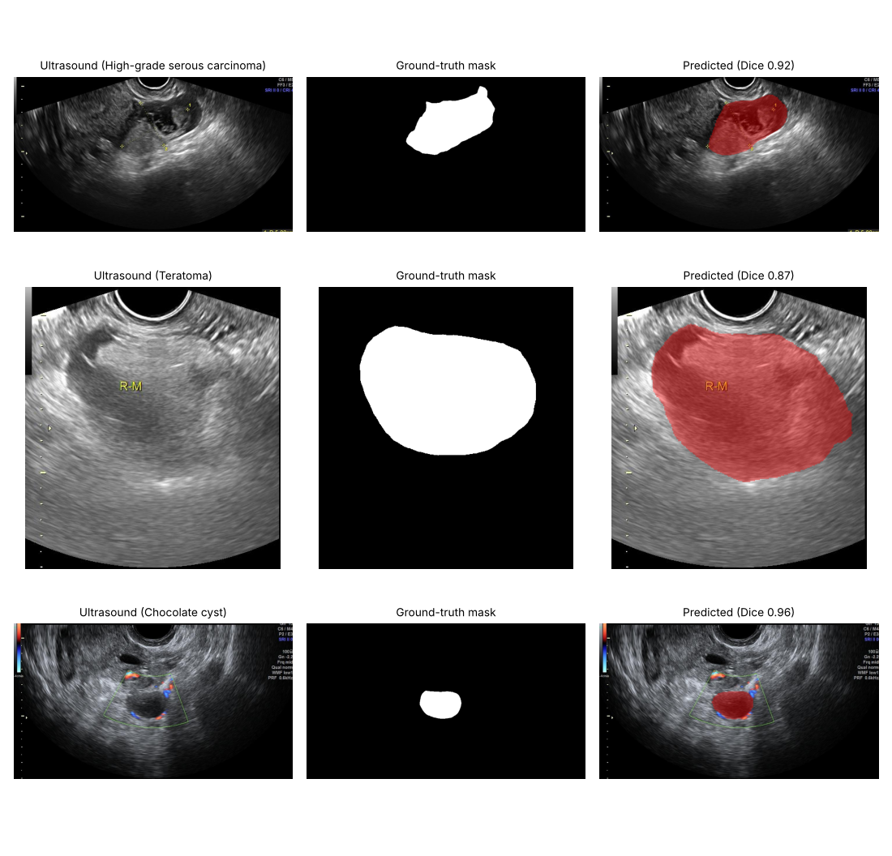
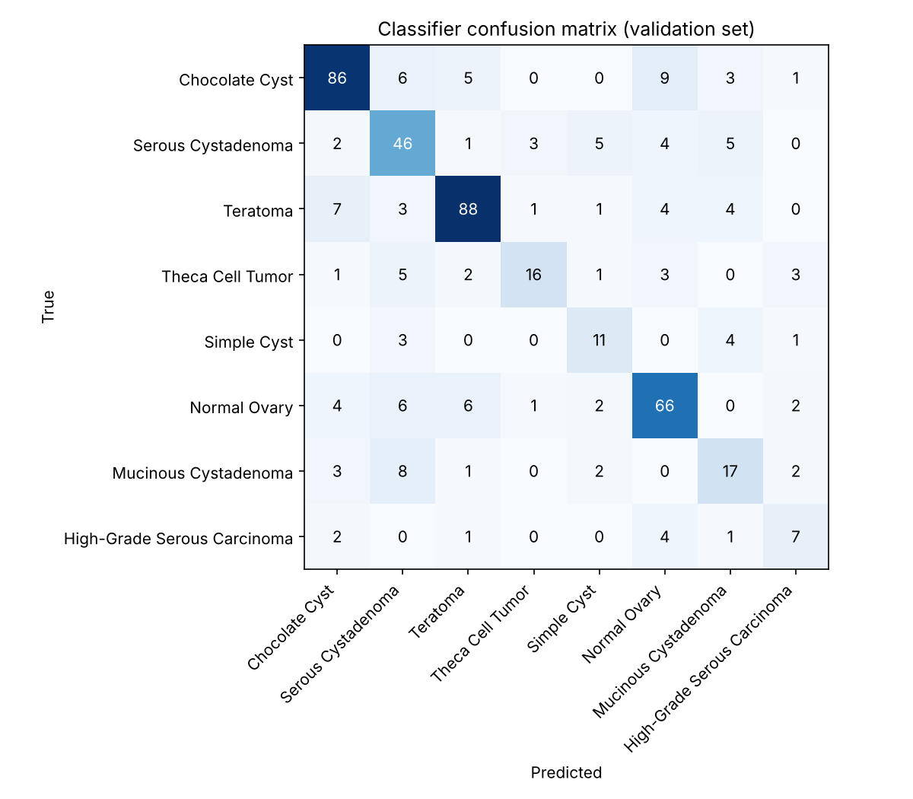
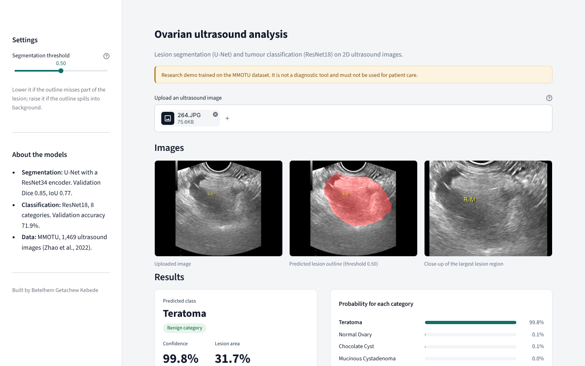

# Ovarian Tumour Segmentation & Classification from Ultrasound Images

Deep learning on the public **MMOTU** ovarian ultrasound dataset: a **U-Net** that outlines the lesion and a **ResNet18** that sorts each image into one of 8 categories (7 tumour types plus normal ovary). Both models sit behind a **Streamlit** app that overlays the segmentation, shows class probabilities and exports a PDF.

**Live demo:** https://ovarian-tumor-diagnosis.streamlit.app/ (free hosting, so the first load can take up to a minute; try one of the sample images).

> ⚠️ **Research and educational project.** Not validated for clinical use and not a diagnostic tool.


*First validation example of three classes: ultrasound, expert mask, and the U-Net's prediction (red).*

---

## The problem

Ultrasound is the first-line imaging test for ovarian masses, but telling tumour types apart depends heavily on the sonographer's experience. This project explores how well standard transfer-learning models can (1) locate the lesion and (2) recognise its type from a single 2D ultrasound image.

## Data

[MMOTU](https://arxiv.org/abs/2207.06799) (Zhao et al., 2022), OTU_2d subset: **1,469 images** from Beijing Shijitan Hospital, with pixel-level lesion masks and an image-level label. I used the official split (1,000 train / 469 validation).

| ID | Class | Train | Val |
|---|---|---|---|
| 0 | Chocolate cyst | 226 | 110 |
| 1 | Serous cystadenoma | 153 | 66 |
| 2 | Teratoma | 228 | 108 |
| 3 | Theca cell tumour | 57 | 31 |
| 4 | Simple cyst | 47 | 19 |
| 5 | Normal ovary | 180 | 87 |
| 6 | Mucinous cystadenoma | 71 | 33 |
| 7 | High-grade serous carcinoma | 38 | 15 |

The classes are imbalanced: the only malignant class has 38 training images.

## Approach

| Task | Model | Training details |
|---|---|---|
| **Segmentation** | U-Net, ResNet34 encoder (ImageNet weights), `segmentation_models_pytorch` | 256×256 input, BCE + Dice loss, Adam (1e-4), flips/rotation/shift-scale augmentation |
| **Classification** | ResNet18 (ImageNet weights), new 8-class head | 256×256 full image, class-weighted cross-entropy + weighted random sampler for imbalance, Adam, ReduceLROnPlateau, early stopping |

## Results (validation set, 469 images)

Measured with `evaluate.py` using the saved weights.

**Segmentation:** mean Dice **0.85**, mean IoU **0.77** (threshold 0.5).

**Classification:** accuracy **71.9%**, macro-F1 **0.64**.

| Class | Precision | Recall | F1 |
|---|---|---|---|
| Chocolate cyst | 0.82 | 0.78 | 0.80 |
| Serous cystadenoma | 0.60 | 0.70 | 0.64 |
| Teratoma | 0.85 | 0.81 | 0.83 |
| Theca cell tumour | 0.76 | 0.52 | 0.62 |
| Simple cyst | 0.50 | 0.58 | 0.54 |
| Normal ovary | 0.73 | 0.76 | 0.75 |
| Mucinous cystadenoma | 0.50 | 0.52 | 0.51 |
| **High-grade serous carcinoma** | **0.44** | **0.47** | **0.45** |



**What this shows:**
- The large classes (chocolate cyst, teratoma, normal ovary) are recognised well. Performance falls with class size.
- The model catches fewer than half of the **high-grade serous carcinomas** (7 of 15), and 4 of the 15 are predicted as *normal ovary*. For a cancer class, this is the most important weakness to fix.
- Segmentation is much stronger than classification: finding the lesion is easier than naming it.

### Limitations

- The checkpoint was chosen by validation accuracy on the same 469 images reported above, so these numbers are slightly optimistic. A separate test split would give an unbiased estimate.
- Single hospital and single dataset: no external validation.
- The classifier sees the full image. The segmentation is shown for context and does not feed into the classification.

**Next steps:** a held-out test split; recall-focused training for the malignant class; classifying the segmented lesion region; Grad-CAM to check what the classifier looks at.

## The app

Upload an ultrasound image to see the predicted lesion outline, a close-up of the lesion, the predicted category with its confidence, and the probability for every category. Results can be downloaded as a PDF summary.



## Run it

```bash
pip install -r requirements.txt
streamlit run app.py
```

The trained weights are included in `Models/` (the app downloads them from Google Drive only if they are missing).

To reproduce the metrics, download MMOTU into `archive/MMOTU/OTU_2d/`, then run:

```bash
python evaluate.py --data archive/MMOTU/OTU_2d --models Models
```

Training notebooks (Google Colab, GPU): `MMOTU_Segmentation.ipynb` and `MMOTU_Classification.ipynb`.

## Project structure

```
├── app.py                 # Streamlit app: segmentation overlay, prediction, PDF export
├── evaluate.py            # Validation metrics, confusion matrix
├── MMOTU_Segmentation.ipynb
├── MMOTU_Classification.ipynb
├── Models/                # Trained weights (U-Net, ResNet18)
├── results/               # metrics.json, confusion matrix, segmentation examples
├── docs/                  # Project presentation
└── requirements.txt
```

## Reference

Zhao, Q., et al. (2022). *MMOTU: A multi-modality ovarian tumor ultrasound image dataset for unsupervised cross-domain semantic segmentation.* arXiv:2207.06799.

## Author

**Betelhem Getachew Kebede**: Data Science & Analytics, USIU-Africa
